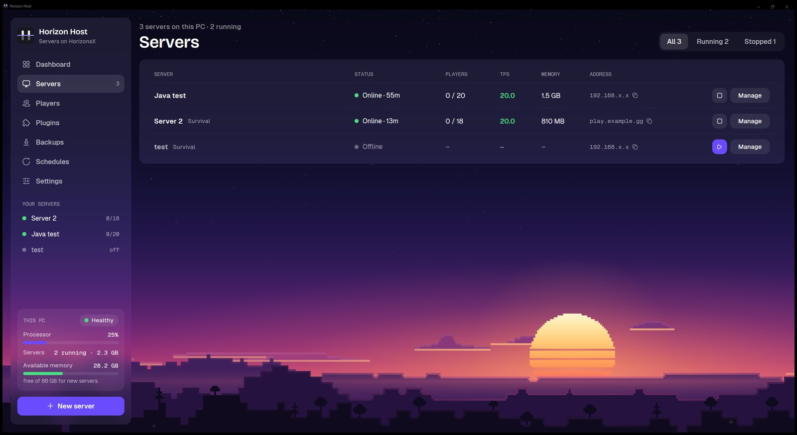
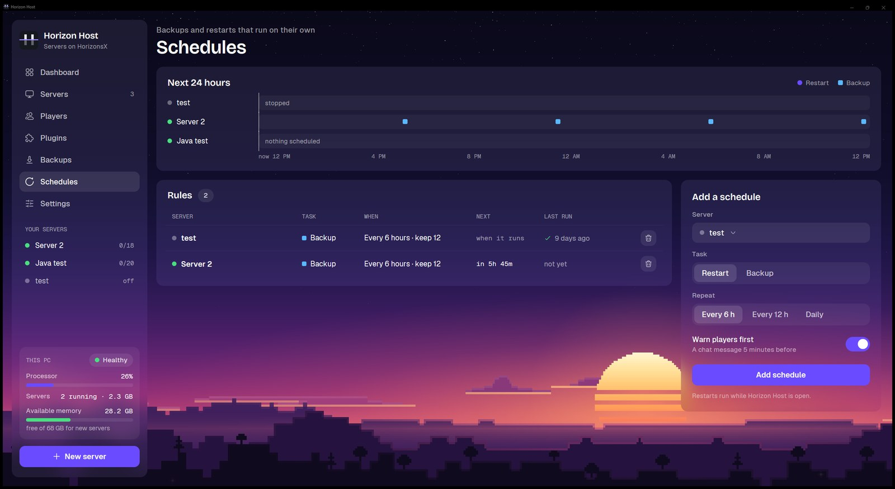
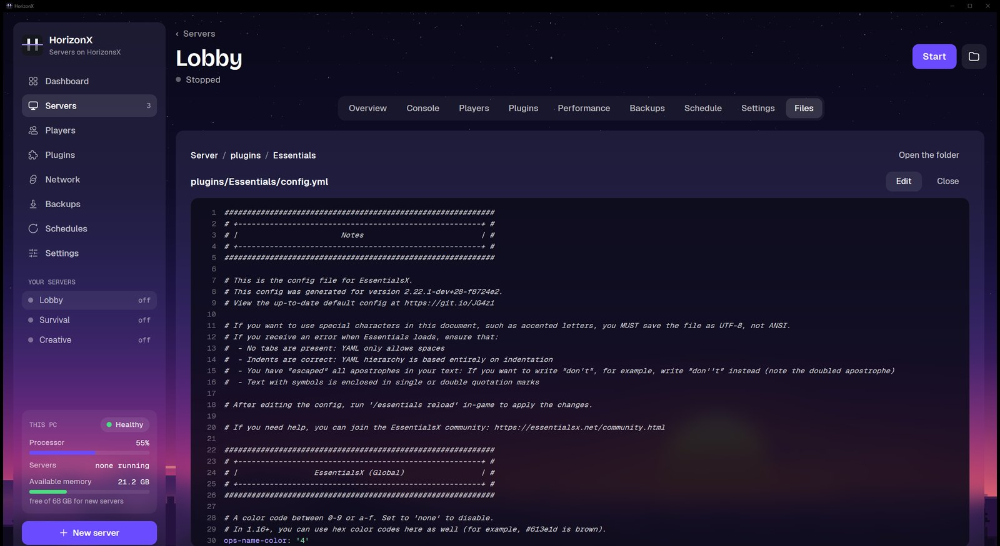

<p align="center">
  
</p>

<p align="center">
  <a href="https://github.com/SaphirePay/HorizonX/releases/latest"><b>Download</b></a> ·
  <a href="#horizonx"><b>HorizonX</b></a> ·
  <a href="#horizonsx"><b>HorizonsX</b></a> ·
  <a href="#sdk"><b>SDK</b></a> ·
  <a href="#java-layer"><b>Java layer</b></a> ·
  <a href="#build-from-source"><b>Build from source</b></a> ·
  <a href="docs/README.md"><b>Docs</b></a>
</p>

# HorizonX

Run your own Minecraft: Java Edition 26.3 server on your PC in a few clicks. Friends join from anywhere with no port
forwarding.

This repository holds four parts that work together, and every program built from them:

| Part | Folder | What it is |
|---|---|---|
| **Programs** | [`programs/`](programs) | Every compiled program in one folder, ready to run: the app, the engine, the proxy, the plugins and the Java layer |
| [HorizonX](#horizonx) | [`host/`](host), [`app/`](app) | The server program: a setup wizard and a dashboard for every server on the PC |
| [HorizonsX](#horizonsx) | [`horizonsx/`](horizonsx) | The server engine, a fork of Horizon tuned for many players |
| [SDK](#sdk) | [`sdk/`](sdk) | Write server plugins in Rust with the Bukkit/Paper API you already know |
| [Java layer](#java-layer) | [`java-layer/`](java-layer) | Runs Bukkit, Spigot and Paper plugin jars unchanged on HorizonsX |

## Download

1. Download from [the latest release](https://github.com/SaphirePay/HorizonX/releases/latest):
   **`HorizonX-<version>-windows-x64.zip`** (Windows) or **`HorizonX-<version>-linux-x64.zip`** (Linux).
2. Unzip it anywhere.
3. Windows: double-click **`HorizonX.exe`**. Linux: run **`./HorizonX`** (the first start adds it to your
   applications menu).

The same programs are in [`programs/`](programs) in this repository: clone it or download it as a zip, then run
`programs/HorizonX.exe` (Windows) or `programs/linux/HorizonX` (Linux). [programs/README.md](programs/README.md) lists
what each file is.

There is nothing else to install. The zip carries the app, the HorizonsX engine and its network proxy, the built-in
plugins, the Java layer with its own Java 25 runtime, and (Windows) the Visual C++ runtime.

**Requirements**

- Windows 10 (1903 or newer) or Windows 11, 64-bit; or
- Linux, 64-bit, glibc 2.35 or newer (Ubuntu 22.04+, Debian 12+, Fedora 36+, Mint 21+, Arch, SteamOS 3...), X11 or
  Wayland, Vulkan or OpenGL. On a server with no screen, `./HorizonX mcp` runs everything without a window
  (it needs `libxkbcommon-x11`).
- Minecraft: Java Edition 26.3, played once on the PC. The first server is prepared from your own copy of the game;
  HorizonX contains no Minecraft code or assets.
- About 2 GB of free memory for each running server.

---

## HorizonX

The server program. It makes a server in five steps, runs every server on the PC from one window, and keeps them
running on their own.

<table>
  <tr>
    <td width="50%"></td>
    <td width="50%"></td>
  </tr>
  <tr>
    <td width="50%"></td>
    <td width="50%"></td>
  </tr>
</table>

**Setup wizard.** Five steps: server type, plugins, world (new or one of yours), performance and review.

- **HorizonsX** is for big servers: region threads let each part of the world tick on its own core.
- **Horizon** keeps one TPS for the whole world, like Paper. Region threads stay one switch away in Settings.

**Dashboard.** The home page shows:

- players over time (1 h, 24 h, 7 d or 30 d), with the peak, busiest hour and average session;
- server health and a performance table, slowest server first;
- this PC's processor load, and how much memory is still free for new servers.

**Each server** has tabs for Overview, Console, Players, Plugins, Performance, Backups, Schedule, Settings and Files.

**Players.** Everyone who has joined is listed. For each player you can see their activity, give or take operator
rights, add them to the whitelist, message them, kick them, or ban and unban them.

**Plugins.** HorizonsX plugins and Java plugins are listed side by side, each with a switch and its settings.

- HorizonsX plugins load and unload while the server runs, with no restart.
- One click installs a built-in plugin: LuckPerms, CoreProtect, WorldEdit, Multiverse, MiniMOTD, Player Warps,
  Voice Chat or Elevators.
- **Get plugins from Modrinth:** search the Paper, Spigot and Bukkit plugins made for 26.3. **Add** puts one on the
  server, or **Add to all** on every server, with the plugins it needs.
- **Add a .jar** puts in a Paper or Spigot plugin; the Java layer comes with it.
- **The Java layer** has its own switch on each server. Off keeps the jars but doesn't load them, and nothing turns it
  back on by itself.

**Networks.** Put several servers behind one address with `horizon-proxy`, HorizonsX's Rust proxy. Pick a lobby;
players move between servers with `/server` and `/hub`. The Network page starts, stops and restarts the whole
network and shows its log.

**Files.** A colour-coded viewer and editor for YAML, JSON, TOML, `server.properties` and logs.



**Schedules.** Restart every 6 hours, every 12 hours or daily, with a chat warning 5 minutes before. Backups run on
their own and keep the newest 12.

**A public address without port forwarding.** The built-in playit.gg plugin gives each server an address friends can
join from anywhere. Turn it off on the Plugins page for a server that should only be reachable on your own network;
it stays off until you turn it back on.

**Works with AI assistants.** HorizonX has a built-in MCP server. Connect Claude Code, Claude Desktop or Cursor in
one click (Settings > AI assistants), then ask in plain words: make a server, add any Modrinth plugin to every server,
change settings, set up the network, or find out why a server lags. It asks you before deleting anything
([AI-ASSISTANTS.md](docs/AI-ASSISTANTS.md)).

**Updates itself.** HorizonX checks its GitHub releases when it opens and every 6 hours. A newer release is
downloaded, checked against its SHA-256 and put in place: the app, the HorizonsX engine, the plugins and the Java layer.
Running servers keep running, because they are separate processes, and take the new engine at their next restart.
Settings > Updates shows what it is doing and has **Check now**. Download the zip once; after that it stays current.

---

## HorizonsX

[`horizonsx/`](horizonsx) is the server engine every HorizonX server runs. It is a fork of
[Horizon](https://github.com/horizon-rust/horizon), the MIT-licensed rewrite of Minecraft: Java Edition 26.3 in Rust.
It speaks the vanilla protocol, so normal Minecraft clients join it as they join any server.

HorizonsX is tuned for player count.

### One clock, every core

Normal Minecraft (and Paper) runs on one clock: a single thread does the whole tick, 20 times a second, every mob,
block, spawn, chunk and player one after the other. However many cores the machine has, that one thread sets the
limit, and when it can't finish a tick in 50 ms the whole server slows down.

HorizonsX keeps the same game clock, 20 ticks a second and never uncapped, so the game runs at normal speed and the
server has one TPS, as on Paper. What changes is who does the work inside each tick. The world is split into regions
far enough apart that they can't touch in one tick, and each region's mobs, blocks, spawning and random ticks run on
their own core at the same time. The clock waits for every region before the next tick starts, so players and
plugins still see one server. Sending chunks and tracking what each player can see run on every core too.

| | Vanilla / Paper | HorizonsX |
|---|---|---|
| Game clocks | 1, at 20 ticks a second | 1, at 20 ticks a second |
| Cores doing each tick's work | 1 | three quarters of the CPU threads (12 on a 16-thread CPU) |
| What sets the limit | the one thread | the busiest region |

This is `horizonsx-region-threads=false` in `server.properties`, and the measurements below use it. With region
threads on (Folia's model), regions far apart keep their own pace instead of waiting for the slowest one; it uses more
RAM.

### More improvements

- **Crowds of mobs:** a region with thousands of mobs splits further into 128-block cells, ticked in four rounds
  across the cores (Folia ticks a region on one core). Measured with about 5,000 mobs in one region: 44.8 to 27.5 ms.
- **Idle mobs:** a mob more than 32 blocks from every player, on the ground with nothing happening to it, ticks one
  tick in eight (Paper's entity activation range).
- **Spawning:** a large spawn area spawns in 8x8-chunk tiles across the cores, with mob caps still exact; it finds the
  players near a chunk with a grid instead of checking every player.
- **Dropped items:** each item's own tick runs on every core, then merges happen in vanilla's order; items merge
  within 2.5 blocks, as on Paper.
- **Sending:** all of a tick's packets to a player go out in one write; chunks are encoded on several cores with a
  shared cache, and at most 8 new chunks a tick go to each player, so someone landing on new land doesn't stall the
  tick for everyone.
- **Locator bar:** each player's waypoints are indexed (vanilla rechecks every pair, which grows with the cube of the
  player count).
- **One work queue:** every parallel job goes on one queue; whichever thread is free takes the largest job left.
- **Smaller savings:** a chunk batch reads each neighbouring chunk once, and the tick queues use a faster hash.
- **Safe by design:** the engine forbids `unsafe` Rust; the parts that run in parallel only read data the compiler
  proves thread-safe.
- **Rust plugins hot-reload:** drop a `.dll` into `plugins/` while the server runs, with no restart.
- **The Paper plugin layer** ([`horizonsx/plugin-layer/`](horizonsx/plugin-layer)): the Paper API surface plugins
  call (events, commands, scheduler, permissions, inventories, boss bars, scoreboards), wired into the engine's hook
  points.

Most of these produce the same packets in the same order as vanilla; a few change random draws or follow Paper's
defaults, and each one has a switch that turns it off.

**Measured** on an AMD Ryzen 7 7800X3D (8 cores) with 64 GB of RAM and an RTX 3060 Ti, Windows 11, one clock, walking
players spread over the map with live mob spawning:

| Players | TPS | ms a tick | p99 | RAM |
|---|---|---|---|---|
| 300 | 20.0 | 28 | 59 ms | 3.7 GB |
| 400 | 20.0 | 38 | 63-82 ms | 4.4 GB |
| 500 | 19.2 | 52 | 96 ms | 5.4 GB |

How it was measured, and every step from 300 to 500 players: [`horizonsx/docs/v2/README.md`](horizonsx/docs/v2/README.md#measured-11-15-the-build-in-this-repository).

Every change, what it differs from vanilla and the switch that turns it off are in
[`horizonsx/docs/v2/README.md`](horizonsx/docs/v2/README.md). Upstream Horizon's own README is
[`horizonsx/README.md`](horizonsx/README.md).

---

## SDK

[`sdk/`](sdk) is how you write server plugins in Rust. It is the Bukkit/Paper API with the same classes and the Java
names in `snake_case`: `player.setHealth(20)` becomes `player.set_health(20.0)`. If you can write the plugin for
Paper, you can write it here.

| Crate | What |
|---|---|
| [`horizon-bukkit`](sdk/horizon-bukkit) | The Bukkit/Paper API: players, worlds, blocks, items, inventories, events, commands, scheduler, configs. Over 11,000 functions, indexed in [`API_INDEX.md`](sdk/horizon-bukkit/API_INDEX.md) |
| [`horizon-mod`](sdk/horizon-mod) | The lower-level mod interface `horizon-bukkit` sits on |
| [`horizon-kit`](sdk/horizon-kit) | Helpers most plugins use: MiniMessage text, chest menus, items, configs, stores, sounds, timers |
| [`examples/`](sdk/examples) | Tested plugins to copy: `heal`, `joinmessage`, `autobroadcast`, `blockstats`, `menu` |
| [`cookbook/`](sdk/cookbook) | Compiled recipes for common jobs: custom items, right-click items, menus, drops, blocks, hunger, mob targeting ([COOKBOOK.md](docs/COOKBOOK.md)) |
| [`mcp/`](sdk/mcp) | An MCP server with 93 tools that let an AI assistant search the whole SDK in a second, hand out working code, check which events the engine fires, and build and test plugins ([MCP-SETUP.md](docs/MCP-SETUP.md)) |

A plugin is a folder with `Cargo.toml`, `plugin.yml` (the same file as on Paper) and `src/lib.rs`:

```rust
use horizon_bukkit::chat_color::GREEN;
use horizon_bukkit::{CommandSender, Plugin, bukkit_plugin};

fn on_heal(sender: &CommandSender, _label: &str, _args: &[&str]) -> bool {
    if let Some(player) = sender.as_player() {
        player.set_health(player.get_max_health());
        player.set_food_level(20);
        sender.send_message(&format!("{GREEN}Healed."));
    }
    true
}

fn on_enable(plugin: Plugin) {
    plugin.set_executor("heal", on_heal);
}

fn on_disable(_plugin: Plugin) {}

bukkit_plugin!(on_enable, on_disable);
```

`cargo build --release` makes a `.dll` (Windows) or `.so` (Linux). Put it in a server's `plugins/` folder and it
loads at once. Start with [`sdk/horizon-bukkit/AI_GUIDE.md`](sdk/horizon-bukkit/AI_GUIDE.md); it walks through a
plugin's files, events, commands, configs and menus.

[`horizonsx/plugins/`](horizonsx/plugins) holds 22 larger plugins built on the SDK, among them
[EssentialsX](horizonsx/plugins/essentialsx), LuckPerms, mcMMO, Multiverse, DeluxeMenus, Plan and TAB. They build
against their own copy of [`horizon-kit`](horizonsx/plugins/horizon-kit); new plugins should use [`sdk/horizon-kit`](sdk/horizon-kit).

**Documentation:** [`docs/`](docs/README.md) covers a first plugin ([GETTING-STARTED.md](docs/GETTING-STARTED.md)),
every common job ([PLUGIN-GUIDE.md](docs/PLUGIN-GUIDE.md)), working code ([COOKBOOK.md](docs/COOKBOOK.md)), the AI
tools ([MCP-SETUP.md](docs/MCP-SETUP.md), [MCP-TOOLS.md](docs/MCP-TOOLS.md)), running servers with an AI assistant ([AI-ASSISTANTS.md](docs/AI-ASSISTANTS.md)), testing ([TESTING.md](docs/TESTING.md))
and a map of this repository ([REPO-MAP.md](docs/REPO-MAP.md)).

---

## Java layer

[`java-layer/`](java-layer) runs Bukkit, Spigot and Paper plugin jars on HorizonsX unchanged, with no rewrite.

- It is a normal HorizonsX plugin (`horizon_java.dll`). With no jar in `plugins/`, Java never starts and costs no
  memory.
- When there is a jar, it starts one Java VM inside the server process and gives plugins the real Paper 26.3 API.
  Each call is answered by the server through the SDK.
- Events reach Java plugins as real Bukkit event objects, and their changes go back to the server. 431 of Paper's 443
  events are supported.
- It also covers commands (Brigadier included), the scheduler, Folia's region schedulers, services, permissions,
  configs, registries and `libraries:` from Maven Central.
- A ProtocolLib API is built in.
- `/plugins` lists Java plugins separately from HorizonsX plugins.

**Limits.** Plugins that reach into the Java server's own code cannot run, because there is no Java Minecraft server
to call. That covers `net.minecraft.*`, CraftBukkit internals such as `getHandle()`, and NMS adapters.

[`java-layer/COVERAGE.md`](java-layer/COVERAGE.md) lists the API gaps.

| Folder | What |
|---|---|
| [`java-layer/rust/`](java-layer/rust) | The server plugin: JVM start-up, the bridge to the SDK, events |
| [`java-layer/java/`](java-layer/java) | The Java side: the Bukkit/Paper implementation plugins see (`build.py` makes `out/lib`) |
| [`java-layer/runtime/`](java-layer/runtime) | `jrt` and `jbridge`, the Java-runtime pieces the bridge is built on |
| [`java-layer/linux/`](java-layer/linux) | Building the layer on Linux |

---

## Build from source

You need Git, Rust (rustup) and Python 3. HorizonsX builds with Rust 1.99.1 (`rustup toolchain install 1.99.1`); the
Java layer also needs JDK 25.

```bash
git clone --recurse-submodules https://github.com/SaphirePay/HorizonX.git
cd HorizonX

# HorizonX
cargo build --release --manifest-path host/Cargo.toml

# HorizonsX with the Paper plugin layer (the engine HorizonX ships)
cargo install --git https://github.com/horizon-rust/horizon-mixins
python horizonsx/tools/v2/paper_build.py hostregions     # -> build/engines/hostregions/horizon-client(.exe)

# An SDK example plugin
cargo build --release --manifest-path sdk/examples/heal/Cargo.toml

# The Java layer
python java-layer/java/build.py
cargo build --release --manifest-path java-layer/rust/Cargo.toml
```

If you cloned without `--recurse-submodules`, run `git submodule update --init` first.

On Linux, the app needs these development packages (Debian/Ubuntu names):
`pkg-config clang libxkbcommon-dev libxkbcommon-x11-dev libwayland-dev libvulkan-dev libfontconfig-dev libfreetype-dev
libasound2-dev libudev-dev libssl-dev libx11-xcb-dev libxcb1-dev`, and the engine `libasound2-dev libudev-dev rsync`.
`packaging/linux/make_package.py` puts the Linux builds together into the release zip.

HorizonX looks for the engine in `engines/horizonsx/` and the plugins in `plugins/` beside its exe. The
`HORIZON_HOST_ENGINE` and `HORIZON_HOST_PLUGINS` variables override those two folders.

Some development scripts under `horizonsx/tools/` and in the docs name the maintainers' own folders. They are dev
tools; nothing in the builds above depends on them.

## Licenses

- HorizonX (`host/`, `app/`): [MIT](LICENSE).
- HorizonsX (`horizonsx/`): MIT, the upstream Horizon license in [`horizonsx/LICENSE`](horizonsx/LICENSE). Third-party
  notices are in [`horizonsx/THIRD_PARTY_NOTICES.md`](horizonsx/THIRD_PARTY_NOTICES.md).
- SDK (`sdk/`): Apache-2.0.
- The Java runtime in the release zip is Eclipse Temurin (GPLv2 with the Classpath Exception); its notices are in
  `java/runtime/legal/`.

Not an official Minecraft product. Not approved by or associated with Mojang or Microsoft.
