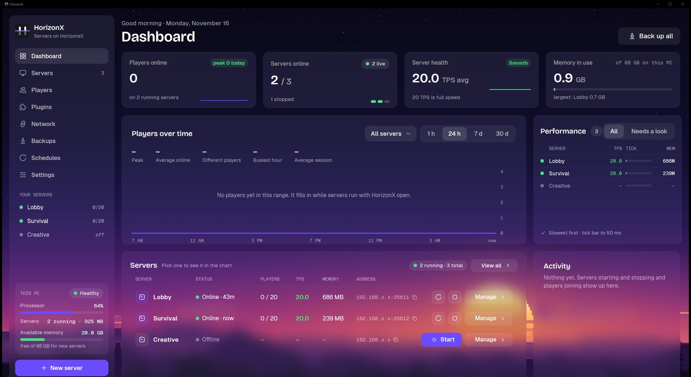
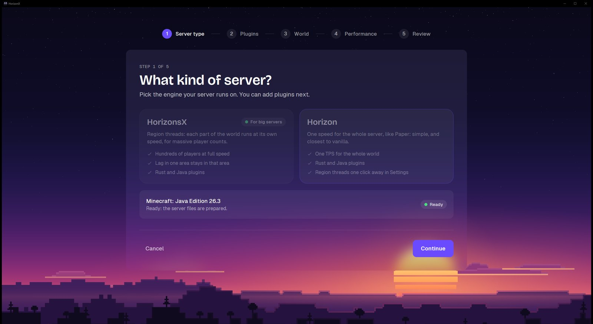
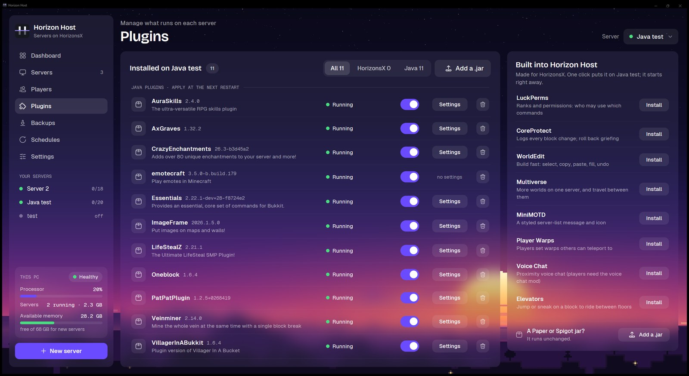

<p align="center">
  
</p>

<p align="center">
  <a href="https://github.com/SaphirePay/HorizonX/releases/latest"><b>Download</b></a> ·
  <a href="#horizon-host"><b>Horizon Host</b></a> ·
  <a href="#horizonsx"><b>HorizonsX</b></a> ·
  <a href="#sdk"><b>SDK</b></a> ·
  <a href="#java-layer"><b>Java layer</b></a> ·
  <a href="#build-from-source"><b>Build from source</b></a> ·
  <a href="docs/README.md"><b>Docs</b></a>
</p>

# Horizon Host

Run your own Minecraft: Java Edition 26.3 server on your PC in a few clicks. Friends join from anywhere with no port
forwarding.

This repository holds four parts that work together:

| Part | Folder | What it is |
|---|---|---|
| [Horizon Host](#horizon-host) | [`host/`](host), [`app/`](app) | The server program: a setup wizard and a dashboard for every server on the PC |
| [HorizonsX](#horizonsx) | [`horizonsx/`](horizonsx) | The server engine, a fork of Horizon tuned for many players |
| [SDK](#sdk) | [`sdk/`](sdk) | Write server plugins in Rust with the Bukkit/Paper API you already know |
| [Java layer](#java-layer) | [`java-layer/`](java-layer) | Runs Bukkit, Spigot and Paper plugin jars unchanged on HorizonsX |

## Download

1. Download **`Horizon-Host-0.2.1-windows-x64.zip`** from [the latest release](https://github.com/SaphirePay/HorizonX/releases/latest).
2. Unzip it anywhere.
3. Double-click **`horizon-host.exe`**.

There is nothing else to install. The zip carries the app, the HorizonsX engine, the built-in plugins, the Java layer
with its own Java 25 runtime, and the Visual C++ runtime.

**Requirements**

- Windows 10 (1903 or newer) or Windows 11, 64-bit.
- Minecraft: Java Edition 26.3, played once on the PC. The first server is prepared from your own copy of the game;
  Horizon Host contains no Minecraft code or assets.
- About 2 GB of free memory for each running server.

---

## Horizon Host

The server program. It makes a server in five steps, runs every server on the PC from one window, and keeps them
running on their own.

<table>
  <tr>
    <td width="50%"></td>
    <td width="50%"></td>
  </tr>
  <tr>
    <td width="50%"></td>
    <td width="50%"></td>
  </tr>
</table>

**Setup wizard.** Five steps: server type, plugins, world (new or one of yours), performance and review.

- **HorizonsX** is for big servers: region threads let each part of the world tick on its own core.
- **Horizon** keeps one TPS for the whole world, like Paper. Region threads stay one switch away in Settings.

**Dashboard.** The home page shows:

- players over time (1 h, 24 h, 7 d or 30 d), with the peak, busiest hour and average session;
- server health and a performance table, slowest server first;
- this PC's processor load, and how much memory is still free for new servers.

**Each server** has tabs for Overview, Console, Players, Plugins, Performance, Backups, Schedule, Settings and Files.

**Players.** Everyone who has joined is listed. For each player you can see their activity, give or take operator
rights, add them to the whitelist, message them, kick them, or ban and unban them.

**Plugins.** HorizonsX plugins and Java plugins are listed side by side, each with a switch and its settings.

- HorizonsX plugins load and unload while the server runs, with no restart.
- One click installs a built-in plugin: LuckPerms, CoreProtect, WorldEdit, Multiverse, MiniMOTD, Player Warps,
  Voice Chat or Elevators.
- **Add a .jar** puts in a Paper or Spigot plugin; the Java layer comes with it.

**Files.** A colour-coded viewer and editor for YAML, JSON, TOML, `server.properties` and logs.


**Schedules.** Restart every 6 hours, every 12 hours or daily, with a chat warning 5 minutes before. Backups run on
their own and keep the newest 12.

**A public address without port forwarding.** The built-in playit.gg plugin gives each server an address friends can
join from anywhere.

**Updates itself.** A new build replaces the app in place. Running servers keep running, because they are separate
processes.

---

## HorizonsX

[`horizonsx/`](horizonsx) is the server engine every Horizon Host server runs. It is a fork of
[Horizon](https://github.com/horizon-rust/horizon), the MIT-licensed rewrite of Minecraft: Java Edition 26.3 in Rust.
It speaks the vanilla protocol, so normal Minecraft clients join it as they join any server.

HorizonsX is tuned for player count. Most of its changes produce the same packets in the same order; a few change
random draws or follow Paper's defaults:

- **Region threads** (Folia's model): parts of the world far enough apart tick on their own cores. This covers block
  ticks, mob ticks, natural spawning and random ticks.
- **One clock on every core:** with `horizonsx-region-threads=false` the whole server keeps one TPS, as on Paper, while
  each tick's work is still spread over three quarters of the CPU threads. The measurements below use this mode.
- **Multi-core sending:** chunk encoding and each player's entity tracking run on a shared worker pool.
- **Paper's defaults:** entity activation range, and an item merge radius of 2.5 blocks.
- **Rust plugins hot-reload:** drop a `.dll` into `plugins/` while the server runs, with no restart.
- **The Paper plugin layer** ([`horizonsx/plugin-layer/`](horizonsx/plugin-layer)): the Paper API surface plugins
  call (events, commands, scheduler, permissions, inventories, boss bars, scoreboards), wired into the engine's hook
  points.

**Measured** on an AMD Ryzen 7 7800X3D (8 cores) with 64 GB of RAM and an RTX 3060 Ti, Windows 11, one clock, walking
players spread over the map with live mob spawning:

| Players | TPS | ms a tick | p99 | RAM |
|---|---|---|---|---|
| 300 | 20.0 | 28 | 59 ms | 3.7 GB |
| 400 | 20.0 | 38 | 63-82 ms | 4.4 GB |
| 500 | 19.2 | 52 | 96 ms | 5.4 GB |

How it was measured, and every step from 300 to 500 players: [`horizonsx/docs/v2/README.md`](horizonsx/docs/v2/README.md#measured-11-15-the-build-in-this-repository).

Every change, what it differs from vanilla and the switch that turns it off are in
[`horizonsx/docs/v2/README.md`](horizonsx/docs/v2/README.md). Upstream Horizon's own README is
[`horizonsx/README.md`](horizonsx/README.md).

---

## SDK

[`sdk/`](sdk) is how you write server plugins in Rust. It is the Bukkit/Paper API with the same classes and the Java
names in `snake_case`: `player.setHealth(20)` becomes `player.set_health(20.0)`. If you can write the plugin for
Paper, you can write it here.

| Crate | What |
|---|---|
| [`horizon-bukkit`](sdk/horizon-bukkit) | The Bukkit/Paper API: players, worlds, blocks, items, inventories, events, commands, scheduler, configs. Over 11,000 functions, indexed in [`API_INDEX.md`](sdk/horizon-bukkit/API_INDEX.md) |
| [`horizon-mod`](sdk/horizon-mod) | The lower-level mod interface `horizon-bukkit` sits on |
| [`horizon-kit`](sdk/horizon-kit) | Helpers most plugins use: MiniMessage text, chest menus, items, configs, stores, sounds, timers |
| [`examples/`](sdk/examples) | Tested plugins to copy: `heal`, `joinmessage`, `autobroadcast`, `blockstats`, `menu` |
| [`cookbook/`](sdk/cookbook) | Compiled recipes for common jobs: custom items, right-click items, menus, drops, blocks, hunger, mob targeting ([COOKBOOK.md](docs/COOKBOOK.md)) |
| [`mcp/`](sdk/mcp) | An MCP server with 93 tools that let an AI assistant search the whole SDK in a second, hand out working code, check which events the engine fires, and build and test plugins ([MCP-SETUP.md](docs/MCP-SETUP.md)) |

A plugin is a folder with `Cargo.toml`, `plugin.yml` (the same file as on Paper) and `src/lib.rs`:

```rust
use horizon_bukkit::chat_color::GREEN;
use horizon_bukkit::{CommandSender, Plugin, bukkit_plugin};

fn on_heal(sender: &CommandSender, _label: &str, _args: &[&str]) -> bool {
    if let Some(player) = sender.as_player() {
        player.set_health(player.get_max_health());
        player.set_food_level(20);
        sender.send_message(&format!("{GREEN}Healed."));
    }
    true
}

fn on_enable(plugin: Plugin) {
    plugin.set_executor("heal", on_heal);
}

fn on_disable(_plugin: Plugin) {}

bukkit_plugin!(on_enable, on_disable);
```

`cargo build --release` makes a `.dll` (Windows) or `.so` (Linux). Put it in a server's `plugins/` folder and it
loads at once. Start with [`sdk/horizon-bukkit/AI_GUIDE.md`](sdk/horizon-bukkit/AI_GUIDE.md); it walks through a
plugin's files, events, commands, configs and menus.

[`horizonsx/plugins/`](horizonsx/plugins) holds 22 larger plugins built on the SDK, among them
[EssentialsX](horizonsx/plugins/essentialsx), LuckPerms, mcMMO, Multiverse, DeluxeMenus, Plan and TAB. They build
against their own copy of [`horizon-kit`](horizonsx/plugins/horizon-kit); new plugins should use [`sdk/horizon-kit`](sdk/horizon-kit).

**Documentation:** [`docs/`](docs/README.md) covers a first plugin ([GETTING-STARTED.md](docs/GETTING-STARTED.md)),
every common job ([PLUGIN-GUIDE.md](docs/PLUGIN-GUIDE.md)), working code ([COOKBOOK.md](docs/COOKBOOK.md)), the AI
tools ([MCP-SETUP.md](docs/MCP-SETUP.md), [MCP-TOOLS.md](docs/MCP-TOOLS.md)), testing ([TESTING.md](docs/TESTING.md))
and a map of this repository ([REPO-MAP.md](docs/REPO-MAP.md)).

---

## Java layer

[`java-layer/`](java-layer) runs Bukkit, Spigot and Paper plugin jars on HorizonsX unchanged, with no rewrite.

- It is a normal HorizonsX plugin (`horizon_java.dll`). With no jar in `plugins/`, Java never starts and costs no
  memory.
- When there is a jar, it starts one Java VM inside the server process and gives plugins the real Paper 26.3 API.
  Each call is answered by the server through the SDK.
- Events reach Java plugins as real Bukkit event objects, and their changes go back to the server. 431 of Paper's 443
  events are supported.
- It also covers commands (Brigadier included), the scheduler, Folia's region schedulers, services, permissions,
  configs, registries and `libraries:` from Maven Central.
- A ProtocolLib API is built in.
- `/plugins` lists Java plugins separately from HorizonsX plugins.

**Limits.** Plugins that reach into the Java server's own code cannot run, because there is no Java Minecraft server
to call. That covers `net.minecraft.*`, CraftBukkit internals such as `getHandle()`, and NMS adapters.

[`java-layer/COVERAGE.md`](java-layer/COVERAGE.md) lists the API gaps.

| Folder | What |
|---|---|
| [`java-layer/rust/`](java-layer/rust) | The server plugin: JVM start-up, the bridge to the SDK, events |
| [`java-layer/java/`](java-layer/java) | The Java side: the Bukkit/Paper implementation plugins see (`build.py` makes `out/lib`) |
| [`java-layer/runtime/`](java-layer/runtime) | `jrt` and `jbridge`, the Java-runtime pieces the bridge is built on |
| [`java-layer/linux/`](java-layer/linux) | Building the layer on Linux |

---

## Build from source

You need Git, Rust (rustup) and Python 3. HorizonsX builds with Rust 1.99.1 (`rustup toolchain install 1.99.1`); the
Java layer also needs JDK 25.

```bash
git clone --recurse-submodules https://github.com/SaphirePay/HorizonX.git
cd HorizonX

# Horizon Host
cargo build --release --manifest-path host/Cargo.toml

# HorizonsX with the Paper plugin layer (the engine Horizon Host ships)
cargo install --git https://github.com/horizon-rust/horizon-mixins
python horizonsx/tools/v2/paper_build.py hostregions     # -> build/engines/hostregions/horizon-client.exe

# An SDK example plugin
cargo build --release --manifest-path sdk/examples/heal/Cargo.toml

# The Java layer
python java-layer/java/build.py
cargo build --release --manifest-path java-layer/rust/Cargo.toml
```

If you cloned without `--recurse-submodules`, run `git submodule update --init` first.

Horizon Host looks for the engine in `engines/horizonsx/` and the plugins in `plugins/` beside its exe. The
`HORIZON_HOST_ENGINE` and `HORIZON_HOST_PLUGINS` variables override those two folders.

Some development scripts under `horizonsx/tools/` and in the docs name the maintainers' own folders. They are dev
tools; nothing in the builds above depends on them.

## Licenses

- Horizon Host (`host/`, `app/`): [MIT](LICENSE).
- HorizonsX (`horizonsx/`): MIT, the upstream Horizon license in [`horizonsx/LICENSE`](horizonsx/LICENSE). Third-party
  notices are in [`horizonsx/THIRD_PARTY_NOTICES.md`](horizonsx/THIRD_PARTY_NOTICES.md).
- SDK (`sdk/`): Apache-2.0.
- The Java runtime in the release zip is Eclipse Temurin (GPLv2 with the Classpath Exception); its notices are in
  `java/runtime/legal/`.

Not an official Minecraft product. Not approved by or associated with Mojang or Microsoft.
